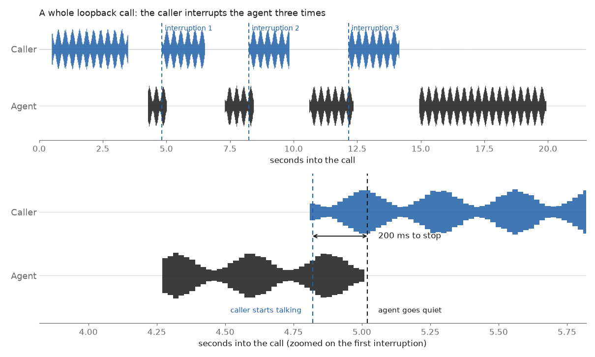
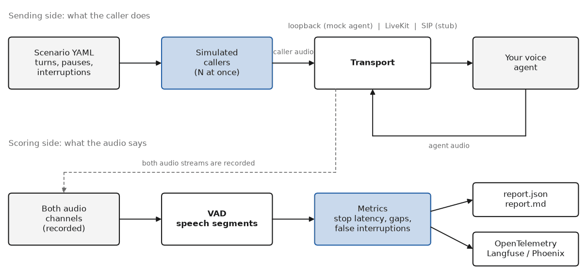
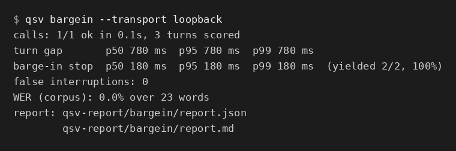
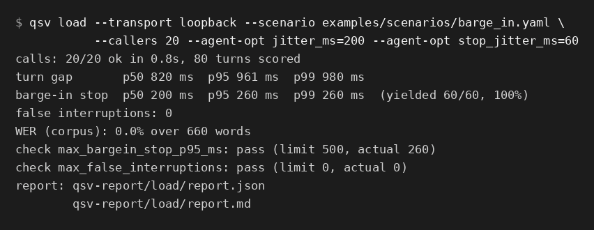
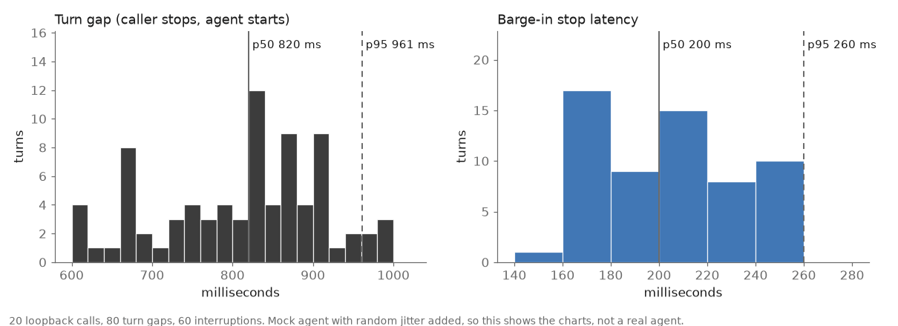

# voice-eval-toolkit

Measure what a caller actually experiences when they talk to a voice agent: how fast it stops talking when you interrupt, how often it cuts you off, how long it leaves you waiting, and how all of that holds up when a few dozen calls hit it at once.

The package is called `qsv` and ships one CLI with two tools:

- **`qsv bargein`** is a barge-in and turn-taking harness. It plays scripted caller audio, with interruptions at the offsets you choose, against an agent and scores stop latency, false interruptions, turn gaps and overlap.
- **`qsv load`** is a simulated-caller load and eval runner. It starts N concurrent scripted callers from YAML scenarios and reports per-turn latency percentiles, barge-in results and (optionally) word error rate, as JSON and Markdown.

It is built by Aqib Nawab as part of the groundwork for QuickStart AI, an open-source voice agent infrastructure project that is still in development. Nothing here claims production traffic. The numbers in this README come from the bundled mock agent and a local LiveKit dev server, and they say so.

[Landing page](https://voice-eval-toolkit.vercel.app) | [Docs](docs) | [Research notes](docs/research.md)



*One loopback call, three interruptions, zoomed in on the first. The agent stops 200 ms after the caller starts talking. This is the bundled mock agent, not a real voice agent, so the 200 ms is simply what the mock was configured to do and what the harness recovered.*

## Why another tool

Pipecat and LiveKit Agents already emit good per-stage timings (TTFB, LLM time to first token, per-turn latency) and OpenTelemetry traces. Langfuse and Phoenix already give you dashboards. What those don't tell you is what happened on the line: did the agent actually go quiet when the caller spoke, and by how many milliseconds? `qsv` treats the agent as a black box, listens to both audio channels with a VAD, and measures from the audio alone, so the same scoring works for any stack. See [docs/research.md](docs/research.md) for the landscape, including the open-source projects that are closest to this one (voicebench, rtpbench, LiveKit EOT Bench) and what is different here.

### How it works



*Scenario in, audio through a transport, metrics out. SIP is a stub for now.*

## Quickstart

```bash
python -m venv .venv && source .venv/bin/activate
pip install -e ".[dev]"

# Barge-in harness against the built-in mock agent (no network, runs in well under a second)
qsv bargein --transport loopback

# Five simulated callers running a scenario
qsv load --transport loopback --scenario examples/scenarios/basic.yaml --callers 5
```

Both commands write `report.json` and `report.md` into `qsv-report/<command>/` (change it with `--out`).

Real output from the first command:

```
calls: 1/1 ok in 0.1s, 3 turns scored
turn gap       p50 780 ms  p95 780 ms  p99 780 ms
barge-in stop  p50 180 ms  p95 180 ms  p99 180 ms  (yielded 2/2, 100%)
false interruptions: 0
WER (corpus): 0.0% over 23 words
report: qsv-report/bargein/report.json
        qsv-report/bargein/report.md
```



*The same output as an image, from the bundled mock agent.*

Those figures describe the mock agent's configured behavior (500 ms endpointing, 300 ms response delay, 120 ms of caller speech to trigger barge-in, 80 ms audio tail), which is exactly what the harness should recover. That is the point of the loopback transport: it gives the analyser a known ground truth and lets the whole toolkit run in CI.

And a load run with 20 simulated callers (random jitter is switched on for the mock agent, so the numbers spread out):



*Output of `qsv load`, taken from a real run against the bundled mock agent. These numbers describe the mock, not a real agent.*



*Turn gap and barge-in stop latency from the same 20 calls. Mock agent again.*

The images in this README are regenerated from real runs with `python scripts/make_images.py` (needs `pip install matplotlib pillow`).

### Install extras

| Extra | Adds | Needed for |
| --- | --- | --- |
| `livekit` | `livekit`, `livekit-api` | `--transport livekit` |
| `otel` | OpenTelemetry SDK and OTLP/HTTP exporter | Langfuse, Phoenix or any OTLP export |
| `wer` | `jiwer` | WER through jiwer (a built-in scorer is used without it) |
| `vad` | `webrtcvad-wheels` | `--vad webrtc` |
| `dev` | pytest, ruff, jiwer, livekit-api, OTel | running the tests |

## CLI examples

```bash
# Interrupt the agent 400, 800 and 1200 ms into its replies, five times in a row
qsv bargein --interrupt-at 400,800,1200 --repeat 5

# Make the mock agent slow to yield, and fail the run if p95 stop latency exceeds 500 ms
qsv bargein --agent-opt stop_latency_ms=600 --max-stop-p95-ms 500     # exit code 1

# An agent with no barge-in at all
qsv bargein --agent-opt barge_in=false

# A scenario file, using the WebRTC VAD, saving a stereo WAV (caller left, agent right)
qsv bargein --scenario examples/scenarios/barge_in.yaml --vad webrtc --save-audio

# 50 callers, 10 at a time, started over 5 seconds, with a pass/fail gate for CI
qsv load --scenario examples/scenarios/telephony_wer.yaml --callers 50 \
         --concurrency 10 --ramp-up 5 --max-wer 0.15

# Check scenario files
qsv validate examples/scenarios/*.yaml
```

Exit codes: `0` success, `1` a limit failed or every call failed, `2` bad usage or configuration.

### Against LiveKit

```bash
pip install -e ".[livekit]"
export LIVEKIT_URL=wss://your-project.livekit.cloud
export LIVEKIT_API_KEY=...  LIVEKIT_API_SECRET=...

qsv load --transport livekit --scenario examples/scenarios/basic.yaml --callers 10 \
         --livekit-agent-name my-agent        # omit for automatic dispatch
```

Each call joins its own room (`qsv-<call id>`), publishes the caller audio as a microphone track and records the agent's audio track. To try it without an agent of your own, run `livekit-server --dev` and `python examples/livekit_mock_agent.py` (see [docs/transports.md](docs/transports.md)).

### Exporting traces to Langfuse or Phoenix

```bash
pip install -e ".[otel]"

# Langfuse (cloud or self-hosted)
export LANGFUSE_PUBLIC_KEY=pk-lf-...  LANGFUSE_SECRET_KEY=sk-lf-...
export LANGFUSE_HOST=https://cloud.langfuse.com        # or your own host
qsv load --scenario examples/scenarios/basic.yaml --callers 5 --otel-preset langfuse

# Arize Phoenix (local default is http://localhost:6006)
qsv load --scenario examples/scenarios/basic.yaml --callers 5 --otel-preset phoenix

# Any OTLP/HTTP backend
qsv load --scenario examples/scenarios/basic.yaml --otel-endpoint http://localhost:4318 \
         --otel-header "x-team=voice" --otel-metrics
```

Every call becomes a trace (`qsv.call`) with one child span per caller turn (`qsv.turn`). Nothing is exported unless you configure it. Details are in [docs/architecture.md](docs/architecture.md#opentelemetry-export).

## Scenarios

```yaml
name: refund-interrupt
sample_rate: 8000
wait_for_greeting_ms: 2000          # let the agent say hello first
turns:
  - say: "Hi, I need a refund for order 1234"
    duration_ms: 2400
    expected_transcript: "hi i need a refund for order 1234"   # WER reference
  - say: "Sorry, it was order 1243"
    interrupt_after_ms: 900          # start talking 900 ms into the agent's reply
  - say: "I want to change my flight to, um, Tuesday"
    duration_ms: 3000
    hesitation: { at_ms: 1400, duration_ms: 900 }              # a mid-sentence pause
agent:                               # loopback mock agent settings
  endpointing_ms: 500
  stop_latency_ms: 100
assertions:                          # optional pass/fail limits
  max_bargein_stop_p95_ms: 500
  max_false_interruptions: 0
```

The caller audio is synthetic speech-like audio by default, or a WAV file per turn (`audio: hello.wav`, resampled to the scenario rate). The full field list is in [`src/qsv/scenario.py`](src/qsv/scenario.py) and the examples live in [`examples/scenarios/`](examples/scenarios).

## Metrics

All timings are measured from the recorded audio with a VAD on both channels. Short definitions here, precise ones in [docs/metrics.md](docs/metrics.md).

| Metric | Meaning |
| --- | --- |
| Barge-in stop latency | Caller speech onset to the moment the agent's audio stops |
| Yield rate | Share of interruptions, with the agent mid-sentence, where it stopped before the caller finished |
| False interruption | The agent started talking before the caller's turn ended, or less than `--min-gap-ms` (300 by default) after it |
| Turn gap | Caller end of speech to the agent's first audio |
| Overlap | Time both sides were speaking at once |
| Time to first audio | Call start to the agent's first audio |
| p50 / p95 / p99 | Percentiles over all scored turns in a run |
| WER | Word error rate of the agent's own transcript of the caller, against the scenario reference |

## What is real and what is simulated

- The **loopback** mock agent is a simulation. Its STT transcripts are fabricated from the scenario text with a configurable error rate, so WER on loopback only proves the plumbing. WER against a real agent needs one that publishes caller transcripts (LiveKit Agents does, on the `lk.transcription` text stream).
- The **LiveKit** transport has been exercised end to end against a local `livekit-server --dev` and the bundled mock agent (an optional integration test, `QSV_LIVEKIT_INTEGRATION=1`). It has not been run against LiveKit Cloud or a production agent worker.
- The **SIP** transport is a stub that raises `NotImplementedError` with guidance. See the roadmap.
- Synthetic caller speech is not intelligible. It is built to behave like speech for an energy VAD (voiced spectrum, syllable-rate wobble). Agents that run a real STT need real recorded audio via `audio:` turns.

## Project layout

```
src/qsv/
  audio.py          synthetic speech, resampling, WAV, mu-law
  vad.py            energy VAD, optional WebRTC VAD, SpeechGate and segments
  scenario.py       YAML scenarios and caller audio
  caller.py         the tick-driven scripted caller
  session.py        run one call over a transport and analyse it
  metrics.py        metric definitions, WER, the call analyser
  load.py           concurrent callers, aggregation, assertions
  report.py         JSON and Markdown reports
  observability.py  OpenTelemetry export (optional)
  transports/       base, loopback, livekit_transport, sip (stub)
  cli.py            qsv bargein | load | validate
site/               the static landing page (deployed on Vercel)
scripts/            make_images.py regenerates docs/images
```

## Roadmap

- SIP transport: LiveKit SIP outbound dialing first, then PJSUA2 for wire-level tests (see [docs/transports.md](docs/transports.md)).
- Pipecat and plain WebSocket transports.
- Telephony impairments on the caller audio: packet loss, jitter, band-limiting with mu-law, background noise and crosstalk.
- Backchannel turns ("mm-hm") that should not make the agent stop, scored as false stops.
- A semantic turn-detection comparison mode: VAD only, transcript triggered and model based, on the same scenarios.
- Streaming-STT WER under the impairments above, against recorded 8 kHz audio.
- Baseline files and regression diffs between two reports.
- A published results page for QuickStart AI once there is something real to measure, with method and limitations stated.

## Development

```bash
pip install -e ".[dev]"
ruff check .
pytest
```

See [CONTRIBUTING.md](CONTRIBUTING.md). MIT licensed.
