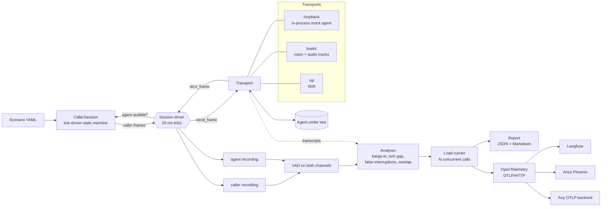

# Architecture

`qsv` has four moving parts: a **scripted caller**, a **transport** to the agent, a **session driver** that ties them together on a frame clock, and an **analyser** that turns the two recorded channels into metrics. A load runner, reporting and OpenTelemetry export sit on top.



## The frame clock

The driver is tick-synchronous. On every tick (20 ms by default) it:

1. asks the caller for its next frame, passing in whether the agent is currently audible,
2. calls `transport.send_frame(frame)`,
3. calls `transport.recv_frame()` and appends what came back to the agent recording,
4. updates a streaming VAD on the agent audio, which is the only thing the caller can "hear".

Real transports (`realtime = True`) are paced against the wall clock. The loopback transport simulates time frame by frame and is not paced, so a 20-second call finishes in milliseconds and a load run of hundreds of calls is cheap. The same code path runs either way.

Why this shape: the caller needs to be **reactive** (start an interruption a set time after the agent begins talking), and a tick loop makes that natural and deterministic. The cost is that transports must map their native audio flow onto one frame in, one frame out. For LiveKit that means some buffering, described below.

## The scripted caller

`CallerSession` is a state machine over ticks. Phases:

```
LEAD_IN -> SPEAKING -> AWAIT_RESPONSE -> COUNTDOWN -> SPEAKING (interruption)
                                      -> AWAIT_END -> PAUSE -> SPEAKING (polite turn)
                                      -> TAIL -> DONE
```

- A **polite** turn waits for the agent to start replying, wait for it to finish (`end_silence_ms` of silence), pause `pause_ms`, then speak.
- An **interrupting** turn (`interrupt_after_ms`) waits for the agent to start replying, then counts down and speaks whether or not the agent is still talking. If the agent never replies within `response_timeout_ms`, the interruption is skipped and recorded as such.
- A **hesitation** is silence inside the turn's own audio, so the caller goes quiet mid-sentence and then continues.
- The caller records, for each turn it speaks, the scheduled start and end. The analyser uses these only to map VAD segments to turns.

## Transports

```python
class Transport(ABC):
    realtime: bool                     # True: the driver paces on the wall clock
    live_lag_ms: float                 # how far recv_frame trails the true timeline
    async def connect(self, ctx: CallContext) -> None
    async def send_frame(self, frame) -> None
    async def recv_frame(self) -> np.ndarray      # exactly one frame, zeros if silent
    def agent_recording(self) -> np.ndarray | None  # authoritative timeline, optional
    async def close(self) -> None
    transcripts: list[TranscriptEvent]             # caller transcripts, if available
```

- **loopback** hosts a simulated agent in-process: its own VAD, endpointing, response delay with seeded jitter, barge-in with minimum speech and stop latency, optional greeting, optional simulated STT errors. It is a mock with known parameters, there to give the analyser ground truth and to make everything testable offline.
- **livekit** joins a room with a token, publishes the caller audio as a microphone track and subscribes to the agent's audio track. Incoming audio is placed on a timeline at its **arrival time**, and the final analysis uses that timeline. The live `recv_frame` view trails it by 60 ms, because audio for a tick only exists once it has arrived, and the caller compensates when it schedules an interruption. It also reads the `lk.transcription` text stream for caller transcripts.
- **sip** is a stub that raises `NotImplementedError` with guidance. See [transports.md](transports.md).

## Analysis

`analyze_call` runs the same `SpeechGate` (energy or WebRTC frame classifier plus an onset filter and a hangover) over both recordings and derives everything from segments. It does not look inside the agent. Metric definitions and their limits are in [metrics.md](metrics.md).

## Load runner

`run_load` creates one transport per call, gives each call a distinct seed (`seed + index`) and runs up to `concurrency` calls at once with an asyncio semaphore, optionally spreading starts over `ramp_up_s`. A failed call (connect error, timeout) becomes a result with `ok = false` and an error string, so one bad call does not abort the run, and `success_rate` shows how many made it. `summarize` pools all scored turns across calls for the percentiles.

## Reports

`report.json` (schema version 1) holds run metadata, the summary, assertion results and every call with every turn. `report.md` is the readable version: run settings, latency percentiles, barge-in table, WER, assertions and a per-call table.

## OpenTelemetry export

Off unless configured. When on, each finished call is exported as a trace:

- root span `qsv.call` with the call's summary attributes (`qsv.false_interruptions`, `qsv.overlap_ms`, `qsv.time_to_first_audio_ms`, `qsv.wer`, and so on),
- one `qsv.turn` child per caller turn, from the caller starting to speak until the agent's reply ends, with `qsv.turn.gap_ms`, `qsv.bargein.stop_latency_ms`, `qsv.bargein.yielded`, `qsv.turn.false_interruption`, `qsv.turn.overlap_ms` and `qsv.turn.wer`.

Spans are emitted after the call, using the measured call timeline for start and end times. Every span carries `session.id` and `langfuse.session.id` set to the run id, `langfuse.trace.name`, and `qsv.scenario`, so a run groups together in both Langfuse and Phoenix. `--otel-metrics` additionally exports histograms (`qsv.turn.gap`, `qsv.bargein.stop_latency`, `qsv.call.overlap`) and counters to `<endpoint>/v1/metrics`, for collectors that take metrics. Langfuse and Phoenix ingest traces only.

### Langfuse

Langfuse takes OTLP over HTTP (protobuf or JSON, not gRPC) at `<host>/api/public/otel`, with Basic auth built from the project keys and an ingestion version header for real-time ingest.

```bash
export LANGFUSE_PUBLIC_KEY=pk-lf-...
export LANGFUSE_SECRET_KEY=sk-lf-...
export LANGFUSE_HOST=https://cloud.langfuse.com      # EU cloud; use us.cloud.langfuse.com for US, or your own host
qsv load --scenario examples/scenarios/basic.yaml --callers 5 --otel-preset langfuse
```

This sends to `<host>/api/public/otel/v1/traces` with `Authorization: Basic base64(public:secret)` and `x-langfuse-ingestion-version: 4`.

Equivalent standard OpenTelemetry environment variables also work with `--otel-endpoint` or no flag at all:

```bash
export OTEL_EXPORTER_OTLP_ENDPOINT="https://cloud.langfuse.com/api/public/otel"
export OTEL_EXPORTER_OTLP_HEADERS="Authorization=Basic <base64 of pk:sk>,x-langfuse-ingestion-version=4"
```

### Arize Phoenix

Phoenix serves OTLP/HTTP on the same port as its UI (6006 locally) at `/v1/traces`.

```bash
phoenix serve                                         # local, no key needed
qsv load --scenario examples/scenarios/basic.yaml --callers 5 --otel-preset phoenix

# Phoenix Cloud or a secured server
export PHOENIX_COLLECTOR_ENDPOINT=https://your-phoenix.example.com
export PHOENIX_API_KEY=...                            # sent as Authorization: Bearer
qsv load --scenario examples/scenarios/basic.yaml --otel-preset phoenix --otel-project voice-evals
```

The project name goes into the `openinference.project.name` resource attribute, which Phoenix uses to group traces.

### Any other backend

`--otel-endpoint http://collector:4318` (a base URL or a full `/v1/traces` URL) with repeated `--otel-header key=value`.

## Testing strategy

The loopback agent's behavior is configured, so tests assert that the harness recovers it: a mock with a 150 ms stop tail should measure a stop latency near 150 ms plus the barge-in trigger time, an impatient endpointing setting should produce a false interruption during a hesitation and a patient one should not. The analyser is also tested directly on hand-built synthetic channels with known segment times. An optional integration test places real WebRTC calls through a local LiveKit server.
